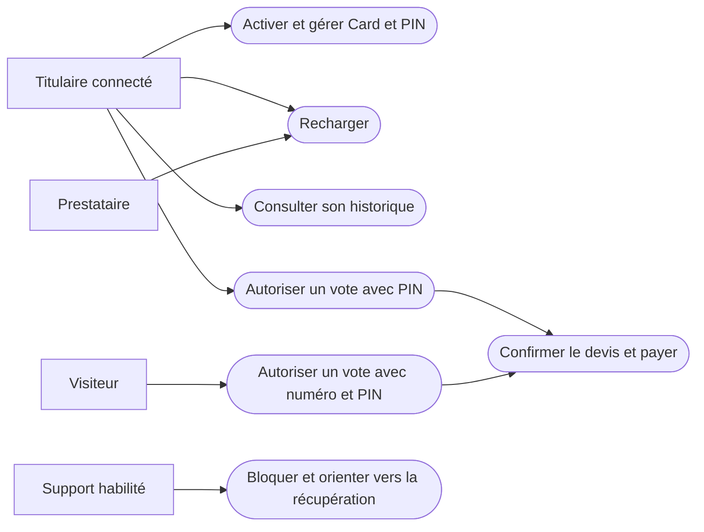
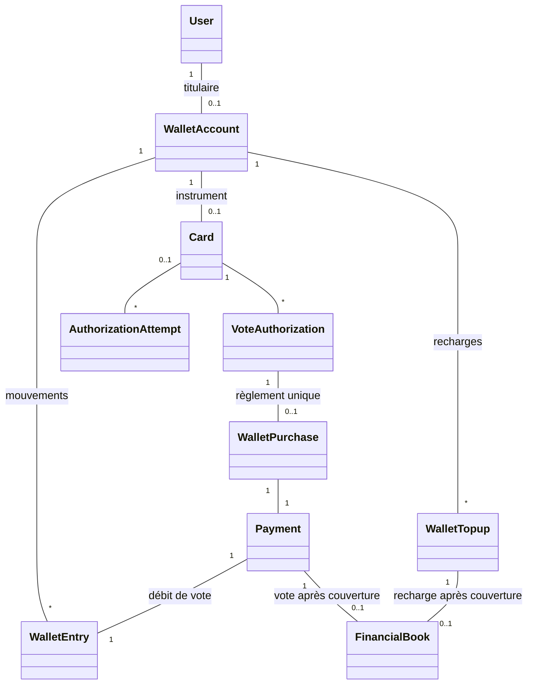
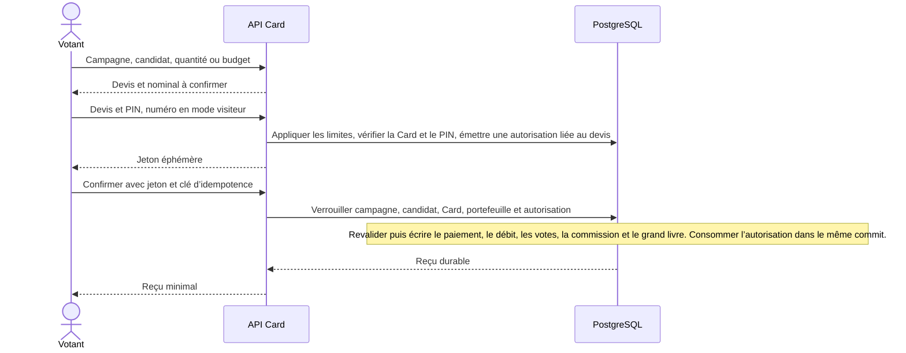

# VoteNow Card — Architecture fonctionnelle et sécurité

## 1. Acteurs et périmètre

Le titulaire active et gère sa Card depuis l’interface actuelle, recharge son portefeuille et consulte son historique. Un votant connecté utilise sa propre Card avec son PIN. Un visiteur peut payer un vote avec le numéro et le PIN, sans ouvrir de session sur le compte du titulaire. Le prestataire confirme les recharges. Le support instruit les incidents via la récupération du compte et un blocage administratif audité. Il ne peut ni lire ni définir un PIN.

Aujourd’hui, `wallet_accounts` porte le solde unique par utilisateur. `wallet_entries` applique les mouvements et `wallet_purchases` garantit l’idempotence des achats. La dépense Card actuelle requiert une session mais passe sans PIN. La recharge ne facture pas encore de frais VoteNow. Le grand livre 29.4 a été validé en schéma isolé. Sa mise en service est un prérequis de l’activation financière de la Card cible. [Routes actuelles](../../src/routes/walletRoutes.js) · [Service portefeuille](../../src/services/wallet.js) · [Grand livre](../../scripts/financial-book.sql)

## 2. Données cibles

| Structure | Évolution minimale |
|---|---|
| `wallet_cards` | Une ligne par portefeuille, FK unique. Numéro chiffré pour la restitution au titulaire, empreinte HMAC unique pour la recherche et suffixe masqué. Hachage du PIN, versions des clés et du justificatif, états `active` et `blocked`, origine du blocage et horodatages. Absence de ligne = Card à activer. |
| `card_vote_authorizations` | Empreinte unique du jeton, Card et version d’autorisation, campagne, candidat, identifiant/hash du devis, devise, nominal et expiration. Consommation liée à un achat unique. Les autorisations expirées sont purgées selon la politique de conservation, avec conservation des références de règlement nécessaires à l’audit. |
| Tentatives et événements | Compteurs partagés à incréments atomiques par Card, empreinte du numéro présenté y compris inconnu, source réseau et plafond global. Journal d’événements minimal et à rétention définie pour les échecs, blocages, réactivations et changements de PIN. Aucun PIN, numéro complet, jeton ou IP brute dans ce journal. |
| `wallet_purchases` | Ajouter une référence d’autorisation unique, nullable pour les achats historiques. Conserver la clé d’idempotence et l’empreinte de la demande. Le paiement garde la référence interne `wallet_user_id` utilisée par le grand livre. Pour un vote public, éviter de recopier le nom et le téléphone du titulaire et exclure tout identifiant titulaire des réponses et exports accessibles au public ou aux organisateurs. |

Le format proposé est `VN-XXXX-XXXX-XXXX-XXXX-XXXX`, avec 20 caractères Crockford Base32 générés uniformément par CSPRNG (100 bits). L’index unique et un nouveau tirage couvrent les collisions. Normaliser la casse et les séparateurs. Le préfixe indique un instrument interne sans lien avec un PAN bancaire. Séparer les clés de recherche HMAC, de chiffrement authentifié et de protection du PIN. Une réémission après compromission remplace le numéro sur la même Card, incrémente sa version et invalide les autorisations actives.

## 3. Parcours et contrats proposés

| Action | Contrat et résultat |
|---|---|
| Activation et lecture | `POST /api/wallet/card` avec PIN et preuve de vérification récente du compte. Sous verrou, réutilise le portefeuille ou appelle l’ouverture existante, sans recréer le solde. `GET /api/wallet` ajoute le statut et le suffixe. Afficher le numéro complet uniquement après vérification récente, via une réponse `no-store`. Les portefeuilles existants conservent leur historique et activent la Card lorsqu’ils configurent leur PIN. |
| PIN et blocage | `PUT /api/wallet/card/pin` avec PIN actuel, nouveau PIN et preuve récente. `POST /api/wallet/card/pin/reset` avec preuve à usage unique liée au compte et à l’action, puis nouveau PIN. Réutiliser la vérification de compte et ses limites existantes. `POST /api/wallet/card/block` révoque les autorisations sous verrou. `POST /api/wallet/card/reactivate` exige une vérification récente et le PIN ou sa réinitialisation. Un blocage posé par le support exige une levée auditée par le support. Les changements sensibles notifient le titulaire par le canal vérifié. |
| Recharge et historique | Conserver `POST /api/wallet/quote`, `POST /api/wallet/topups`, `GET /api/wallet/topups/:id` et `GET /api/wallet/history`, réservés au titulaire. Le devis et la confirmation distinguent principal, frais VoteNow, total demandé et éventuelle surcharge opérateur. Un blocage suspend les votes et les nouvelles recharges. Une recharge acceptée avant le blocage suit son rapprochement initial et crédite le principal confirmé. L’historique reste accessible au titulaire. |
| Devis de vote | `POST /api/card-votes/quote` avec campagne, candidat et quantité ou budget. Produit un devis opaque intègre, à durée courte, et présente quantité, nominal, frais zéro et total Card. Le devis public ne requiert aucune donnée Card et ne révèle ni commission interne ni solde. |
| Autorisation | `POST /api/card-votes/authorizations` avec devis et PIN. En session, sélectionner automatiquement la Card personnelle côté serveur. En mode visiteur, demander le numéro. Renvoie seulement un jeton opaque et son expiration, au plus deux minutes et jamais après le devis. Toute modification du devis exige une nouvelle autorisation. |
| Confirmation | `POST /api/card-votes/payments` avec le jeton dans un en-tête dédié et `Idempotency-Key`. Renvoie un reçu minimal avec état, référence opaque, campagne, candidat et montant. En cas de réponse perdue, le même jeton et la même clé rendent le même reçu pendant une fenêtre bornée, même après expiration de l’autorisation de débit. Une autre clé ou un autre contexte ne peut déclencher de paiement avec un jeton consommé. |

## 4. Sécurité et invariants

- PIN numérique de **six chiffres générés uniformément par le client officiel et confirmés à l’enrôlement** (zéros initiaux acceptés), soit un million de possibilités. Un espace aussi court exige des limites strictes. Conserver uniquement un vérificateur Argon2id avec sel par Card et pepper séparé en coffre de secrets. Calibrer le coût sous charge, borner la concurrence du hachage et prévoir une rotation versionnée, avec réinitialisation en cas de compromission. Le PIN transite sous TLS et est exclu des traces HTTP, de l’APM, des événements, des URL et du stockage navigateur. [OWASP Password Storage](https://cheatsheetseries.owasp.org/cheatsheets/Password_Storage_Cheat_Sheet.html)
- Paramètres initiaux à valider en simulation. Temporisation progressive, cinq échecs consécutifs par Card avant blocage temporaire de 15 minutes, plafond glissant de dix sur 24 heures avant récupération vérifiée. Appliquer également des plafonds par numéro présenté, source et global pour contenir le trafic distribué. Les échecs doivent être comptés même si la transaction métier est annulée. Utiliser un vérificateur factice de coût comparable pour les numéros inconnus et des réponses publiques uniformes pour Card absente, bloquée ou PIN incorrect. Éviter les notifications répétées lors des attaques par blocage. En cas d’indisponibilité des limites centralisées, refuser l’autorisation.
- Le jeton aléatoire de 256 bits est stocké sous forme d’empreinte et reste en mémoire côté client. Il est lié au devis exact, à la campagne, au candidat et à la version de la Card. En mode connecté, il est aussi lié au compte et à la session émettrice. En mode visiteur, le contexte de paiement est isolé de toute session de compte. Les endpoints imposent TLS, une politique d’origine restrictive et la protection CSRF là où les identifiants de session sont automatiques. Aucun endpoint public de solde, d’identité ou d’historique. En cas de refus public après autorisation, message générique sans solde ni motif sensible.
- Au règlement, retenir un ordre de verrous commun à tous les écrivains. Vérifier sur la base l’heure d’expiration, l’état de la Card, sa version, le devis courant, l’activité de la campagne et du candidat, le nominal, la commission et le solde. Une modification du prix ou du contexte impose un nouveau devis explicite. Un changement de PIN, de statut ou de numéro incrémente la version sous verrou. En cas d’échec, annuler le débit, les votes et les écritures ensemble. Les contraintes uniques sur l’autorisation, la clé d’idempotence et les sources de journal complètent les verrous contre les doubles règlements.
- À la bascule, faire passer toutes les dépenses Card par la même autorisation et le même service transactionnel. Faire échouer l’ancien contrat de dépense directe sur les Cards migrées, y compris pour les anciens clients. Les retraits organisateurs restent hors du périmètre de l’autorisation Card.

## 5. Finance et séquencement

- Recharge de **1 000 FCFA** au taux initial de 5 %. Demande de **1 050 FCFA**, crédit Card de **1 000 FCFA** après confirmation authentifiée du prestataire. Figer le tarif VoteNow et le contrat prestataire au devis, réutiliser le Provider Manager, les webhooks validés et la clé unique de recharge. Adapter explicitement la validation des anciennes recharges sans frais et des nouvelles avec frais. Préserver les anciens devis. Le grand livre débite les encaissements à recevoir de 1 050, crédite la dette Card de 1 000 et les frais VoteNow de 50. Les coûts réels restent rapprochés séparément.
- Vote Card de **1 000 FCFA**, commission de **150** à 15 %, crédit organisateur de **850**. Débiter le solde Card exactement une fois. Le grand livre débite la dette Card et crédite le disponible organisateur et la commission, sans nouvelle collecte de trésorerie ni frais. Appliquer l’arrondi au franc, demi-franc vers le haut, au total nominal. Le journal portefeuille conserve ses écritures opérationnelles. Le grand livre reprend la source unique et reste seul utilisé pour les agrégats comptables. [Modèle 29.2](modele-financier-votenow.md)
- **Ordre proposé**. 1) Valider la mise en service du socle 29.4 et verrouiller les contrats et scénarios de concurrence. 2) Ajouter les tables, clés, limites et parcours de gestion en conservant la composition de l’interface actuelle. 3) Adapter le service de vote existant et basculer les parcours connectés vers le PIN, avec fermeture de l’ancien chemin de débit. 4) Activer séparément le parcours visiteur après vérification des limites, de la confidentialité des réponses, des rejeux et des blocages concurrents. 5) Activer les frais de recharge lors de la mission dédiée, après validation de l’encaissement, du crédit intégral et du rapprochement.
